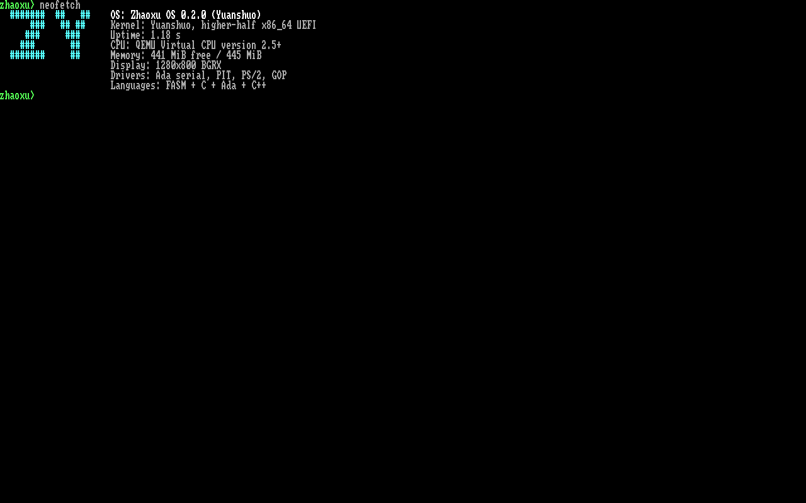

# Zhaoxu OS

Zhaoxu OS 是一个面向 x86_64 的多语言操作系统，内核代号 **Yuanshuo**，当前版本 **0.5.0**。引导加载器 **ZhaoxuBootloader** 同时支持 UEFI 与 legacy BIOS 两种启动模式：UEFI 层用 FASM 直接生成 PE64 EFI 映像，BIOS 层由 MBR 引导扇区与 stage 2 组成；两者建立恒等映射与 higher-half 页表，进入 C 内核，外设驱动用 Ada，交互 Shell 用 C++20 编写，全部链接进同一个内核镜像。0.5.0 引入 Desktop-Shell 图形桌面与图形安装器（AHCI 写入），0.4.0 引入 TrueType 中文渲染与自研 `.zxe` 可执行文件格式（继续兼容 ELF64）。

<!-- 就你晒着，就你晒着，你晒最多 -->



## 0.5.0 新增

- Desktop-Shell / DS-WM（Aqua 风格）：渐变菜单栏与 RTC 时钟、可拖动/关闭/层叠窗口、Dock、软件光标，标题与正文走 TrueType 中文字形
- PS/2 鼠标：IRQ12 三字节包解析、溢出与符号位处理，桌面窗口拖动/关闭与安装器按钮均可点击
- 图形安装器：桌面「安装」窗口或 Shell `install` 启动，把只读安装介质（`ZHAOXUEFI` FAT16 ESP 镜像）按原始扇区复制进目标盘的新 MBR 分区（类型 0x0E，起始 LBA 2048）
- 安装安全校验：目标盘必须是空白盘或旧 Zhaoxu MBR，安装介质与 `ZHAOXUDATA` 数据盘永不作为目标；写入后校验分区起始扇区并 flush
- AHCI 写入路径：WRITE DMA EXT / FLUSH CACHE EXT，PRDTL 仅在有数据时置位
- Shell 新增 `disks`（磁盘、卷标与角色）与 `install [disk]`；`tools/screenshot.rb` 无头抓取桌面 PNG

## 0.4.0 新增

- TrueType 中文渲染：内核内置 glyf 字形引擎（TTC/sfnt 解析、cmap format 4/12、整型 26.6 定点扫描线光栅化、256 槽字形缓存），控制台按 UTF-8 解码，西文走 8x8 点阵、中文走 16px 矢量字形
- 字体分发：文泉驿微米黑（`/mnt/WQY.TTC`，GPL）随 FAT32 数据盘提供，启动时经 `vfs_read_into` 载入常驻内核页，不走 4 MiB 内核堆
- `.zxe` 自研可执行格式：32 字节头 + 40 字节段表 + 原始数据，页对齐映射、R/W/X 段标志；构建期用纯 Ruby 脚本 `tools/zxe-pack.rb` 把 ELF64 转换为 `.zxe`
- 加载器双格式：`run` / `/bin/init` 按魔数自动分发 `.zxe` 与 ELF64，ELF 路径完全保留
- Shell 新增 `fonttest <hex>`：把任意码点的光栅结果以 ASCII 密度图打印到串口

## 0.3.0 新增

- ring 3 用户进程：ELF64 加载、用户页映射、16 KiB 进程内核栈与 TSS `rsp0` 切换
- 系统调用 ABI：`int 0x80`，`rax` 为调用号，`rdi/rsi/rdx` 传参；支持 exit/write/getpid/open/read/close/uptime
- initramfs：ustar 归档嵌入内核镜像，解析为只读 ramfs 根文件系统
- 存储：PCI 扫描 → AHCI（SATA）驱动，IDENTIFY / READ DMA EXT，4 KiB bounce buffer
- FAT32：只读挂载到 `/mnt`，支持 LFN、子目录与簇链读取；按卷标 `ZHAOXUDATA` 选择数据盘
- VFS：统一 `/`（ramfs）与 `/mnt`（FAT32）路径，提供只读文件描述符
- 启动时自动以 ring 3 运行 `/bin/init`；Shell 新增 `ls`、`cat`、`run`、`mounts`
- 用户态缺页/异常只终止当前进程并回到 Shell，内核异常仍然 panic

## 已实现

**引导（FASM）**

- PE64 EFI 应用，位置无关代码，GOP 帧缓冲探测（1280x800 / BGRX）
- 传递 ACPI RSDP 与 UEFI 内存映射
- 前 4 GiB 恒等映射（2 MiB 大页）+ 16 MiB higher-half 内核窗口
- 复制内核镜像到页对齐物理内存，`ExitBootServices` 后切换 CR3，跳转 `0xffffffff80000000`

**内核（C）**

- GDT/TSS（双故障与 NMI 使用独立 IST 栈）、IDT、8259 PIC 重映射
- PIT 100 Hz 节拍、PS/2 键盘 IRQ、COM1 串口轮询输入
- 异常处理：内核异常打印向量、错误码、CR2、RIP/RSP/寄存器现场后停机；CPL3 异常终止进程并返回 Shell
- 物理页位图分配器（4 GiB 范围）、4 KiB 粒度虚拟映射、4 MiB 内核堆
- `kprintf` / `ksnprintf`、字符串库、图形 + 串口双路控制台
- 8x16 字体渲染、滚动、16 色 VGA 调色板与 ANSI 串口颜色映射

**用户态与文件系统（C）**

- ELF64 与 `.zxe` 用户程序加载到 4 GiB 基址，用户栈位于 8 GiB，进程共享内核页表但页级 `U/S` 隔离；`int 0x80` 系统调用入口（IDT DPL=3），用户指针逐页校验
- `int 0x80` 系统调用入口（IDT DPL=3），用户指针逐页校验
- 内嵌 ustar initramfs → 只读 ramfs；`/bin/init`、`/etc/motd` 等随内核分发
- AHCI 块设备（PCI class 01/06/01），FAT32 只读驱动挂载到 `/mnt`
- VFS 路径分发与只读 fd 表，用户程序通过 open/read/close 访问两个文件系统；无数据盘时 `/mnt` 自动回退到 initramfs 内嵌数据镜像 `/data`（无中文字体，CJK 回退 `?`）

**驱动（Ada）**

- 16550 UART、PIT、PS/2 控制器、GOP 矩形填充 / 字形绘制 / Alpha 混合 / 行复制
- 通过 `pragma Export, Convention => C` 暴露 C 符号，端口 I/O 由 C 侧辅助函数完成

**平台**

- CPUID：厂商、品牌、家族/型号/步进、逻辑 CPU 数与特性位
- CMOS RTC：BCD/二进制、12/24 小时制处理
- PCI：配置空间扫描与设备分类
- ACPI：RSDP 校验、RSDT/XSDT 遍历、FADT 解析、DSDT 中 `_S5` AML 解析
- ACPI 关机 / 重启，并为 QEMU q35、i440fx 与键盘控制器提供回退路径

**Shell（C++20）**

| 命令 | 说明 |
| --- | --- |
| `help` | 命令列表 |
| `clear` | 清屏 |
| `echo <text>` | 输出文本 |
| `version` | 版本、构建时间、工具链 |
| `uname` | 系统标识 |
| `mem` | 物理内存与内核堆统计 |
| `uptime` | 运行时间与节拍数 |
| `cpu` | CPUID 详情与特性 |
| `date` | CMOS 实时时钟 |
| `pci` | PCI 设备枚举 |
| `acpi` | ACPI 电源管理信息 |
| `ls [path]` | 列出 ramfs / FAT32 目录 |
| `cat <path>` | 输出文件内容 |
| `run <path> [args...]` | 以 ring 3 运行 `.zxe`/ELF64 程序并打印退出码 |
| `fonttest <hex>` | 光栅化指定 Unicode 码点并输出 ASCII 密度图 |
| `mounts` | 显示已挂载文件系统 |
| `bench` | memset 带宽与 TSC ALU 基准 |
| `sleep <ms>` | 休眠指定毫秒 |
| `desktop [seconds]` | 启动 Desktop-Shell 图形桌面，ESC 退出 |
| `disks` | 列出 AHCI 磁盘、卷标与角色（媒体/数据/目标） |
| `install [disk]` | 把安装介质复制到空白目标盘（缺省自动选择） |
| `color <fg> <bg>` | 设置控制台颜色（0-15） |
| `neofetch` | 系统摘要 |
| `reboot` | ACPI 重启 |
| `shutdown` | ACPI 关机 |
| `panic` | 触发页故障，验证异常处理 |

行编辑支持退格、`Ctrl+L` 清屏、`Ctrl+C` 取消当前行。

## 构建与运行

构建链运行在 WSL2（Ubuntu 26.04）中，Windows 侧脚本只做转发。需要 PowerShell 7+。

```powershell
# 构建并部署到 esp/EFI/BOOT/BOOTX64.EFI
./src/build.ps1

# 仅串口输出（无图形）的构建变体
./src/build.ps1 -Headless

# QEMU + OVMF 启动，串口接到当前终端
./src/run.ps1

# 使用 WSLg 打开 QEMU 图形窗口
./src/run.ps1 -Display gtk
```

也可以直接在 WSL 中构建：

```bash
cd src                     # 仓库内的 src 目录（WSL 下用 wslpath 换算盘符）
make -j4
make run                 # 无头 + 串口
make run QEMU_DISPLAY="-display gtk"
make iso                 # 生成 UEFI + legacy BIOS 双启动 ISO：out/zhaoxu-os.iso
make run-iso             # 从 ISO 启动（UEFI），并挂载 out/data.img
make run-bios            # 从 ISO 启动（SeaBIOS，走 MBR 引导链），并挂载安装盘
```

依赖：

- WSL2 Ubuntu 26.04：`gcc`、`g++`、`gcc-14` + `gnat-14`（提供 `gnat1`）、`ld.lld`、`objcopy`、`qemu-system-x86_64`、`ovmf`、`dosfstools`、`mtools`、`tar`、`xorriso`
- Flat Assembler 1.73.34：仓库自带 `src/tools/fasm`；缺失时可执行 `src/tools/install-fasm.sh`
- Ruby：`.zxe` 转换脚本 `src/tools/zxe-pack.rb` 与冒烟脚本 `src/tools/smoke.rb` 需要 Ruby；WSL 内没有 Ruby 时，Makefile 通过 `RUBY` 变量调用 Windows 侧解释器（按本机安装位置用 `make RUBY=<windows-ruby 的 wslpath 路径>` 覆盖）

## 目录结构

```
Zhaoxu OS/
├── LICENSE                  Apache License 2.0 全文
├── THIRD_PARTY_NOTICES.md   第三方代码与字体声明
├── AGENTS.md                仓库约定
├── docs/                    截图
└── src/
    ├── Makefile             WSL2 内的编译、链接与 QEMU 规则
    ├── build.ps1            构建入口（转发 WSL2 make）
    ├── run.ps1              QEMU/OVMF 运行入口
    ├── boot/                FASM：UEFI 引导层、legacy BIOS stage 1/2 与 UEFI 常量
    ├── kernel/
    │   ├── arch/x86_64/     入口、GDT/TSS、中断桩、PIC、CPUID、端口 I/O、ring 3 切换
    │   ├── int/             IDT 与异常/IRQ/系统调用分发
    │   ├── drivers/         PIT、键盘、RTC、PCI、ACPI、AHCI
    │   ├── fs/              initramfs（ustar/ramfs）、FAT32、VFS、安装器
    │   ├── proc/            ELF64 / .zxe 加载、用户页管理、系统调用
    │   ├── mem/             PMM、VMM、堆
    │   ├── lib/             字符串、printf、UTF-8 控制台、C++ 运行时
    │   ├── font/            font8x8 字体数据、TrueType glyf 光栅化引擎
    │   └── include/         内核公共头文件
    ├── drivers/             Ada：串口、PIT、PS/2 键盘与鼠标、GOP
    ├── apps/                C++：Shell、Desktop-Shell
    ├── user/                ring 3 程序（init、hello）与用户库/链接脚本
    ├── initramfs/           ramfs 初始内容（motd、version、测试文本）
    ├── initramfs/data/      生成 FAT32 数据盘的素材（WQY.TTC 字体等）
    ├── tools/               FASM、zxe-pack.rb（ELF→.zxe）、bios-img.rb、smoke.rb、screenshot.rb
    ├── esp/                 构建出的 UEFI 引导目录
    └── out/                 构建产物（含 FAT32 数据盘 data.img、启动 ISO）
```

## 引导流程

ZhaoxuBootloader 有两套引导层，共用同一份内核镜像与 `boot_info` 契约。

UEFI：

1. UEFI 固件加载 `esp/EFI/BOOT/BOOTX64.EFI`（FASM 生成的 PE64 EFI 映像）。
2. 引导层取得 GOP 帧缓冲、ACPI RSDP 与 UEFI 内存映射。
3. 分配并复制内核 flat binary，建立恒等映射与 higher-half 页表。
4. 调用 `ExitBootServices`，切换 CR3，跳转到 higher-half 内核入口。

legacy BIOS：

1. SeaBIOS 从 ISO 的 El Torito 入口或安装盘的 MBR 加载 stage 1（512 字节引导扇区）。
2. stage 1 用 INT 13h CHS 读把 stage 2 载入 0x8000。
3. stage 2 选择 32bpp VBE LFB、收集 E820 内存图、扫描 ACPI RSDP，并把内核整块读入 0x10000。
4. stage 2 把内核复制到 32 MiB 物理窗口、清零整个窗口、建立恒等映射与 higher-half 页表，写入 `boot_info` 后进入长模式。

公共：

5. 内核建立 GDT/IDT，初始化 PMM/VMM/堆、CPUID、ACPI、RTC、AHCI 与 VFS（initramfs + FAT32），并从数据盘加载 TrueType 中文字体。
6. 启用中断，打印启动日志；自动以 ring 3 运行 initramfs 中的 `/bin/init`。
7. `/bin/init` 通过系统调用读取 `/etc/motd` 与 `/mnt` 下的 FAT32 文件，退出后回到内核。
8. 内核进入 C++ Shell 提示符；`run` 命令可再次加载并运行 ring 3 的 `.zxe` 或 ELF64 程序。

内存布局要点：

- 内核虚拟基址：`0xffffffff80000000`，内核栈顶 `0xffffffff80f00000`
- 内核堆虚拟基址：`0xffffffff90000000`
- 物理内存管理范围：前 4 GiB，4 KiB 页

## 当前限制

- 单核、无调度器；同一时刻只运行一个 ring 3 进程，无 fork/exec 语义
- 文件系统只读：FAT32 不支持写入/创建，块设备驱动仅覆盖 AHCI（无 NVMe/USB）
- 用户进程共享内核页表，依靠页级 `U/S` 位隔离，尚无独立地址空间
- 无网络协议栈
- 输入仅 PS/2 键盘与 COM1 串口，显示输出依赖 UEFI GOP 或 VBE LFB 帧缓冲
- ACPI `_S5` 通过 DSDT AML 模式匹配解析，覆盖常见固件；无法匹配时回退探测

## 许可证

本项目采用 [Apache License 2.0](LICENSE)。第三方组件声明见 [THIRD_PARTY_NOTICES.md](THIRD_PARTY_NOTICES.md)。

Copyright © 2026 Nexsteaduser. All Rights Reserved. 联系邮箱：admin@nexsteaduser.com
