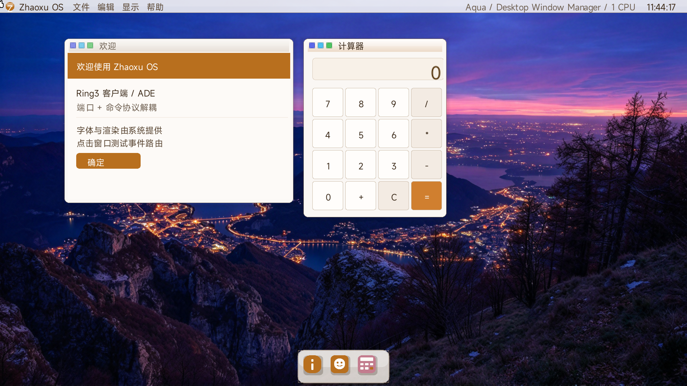
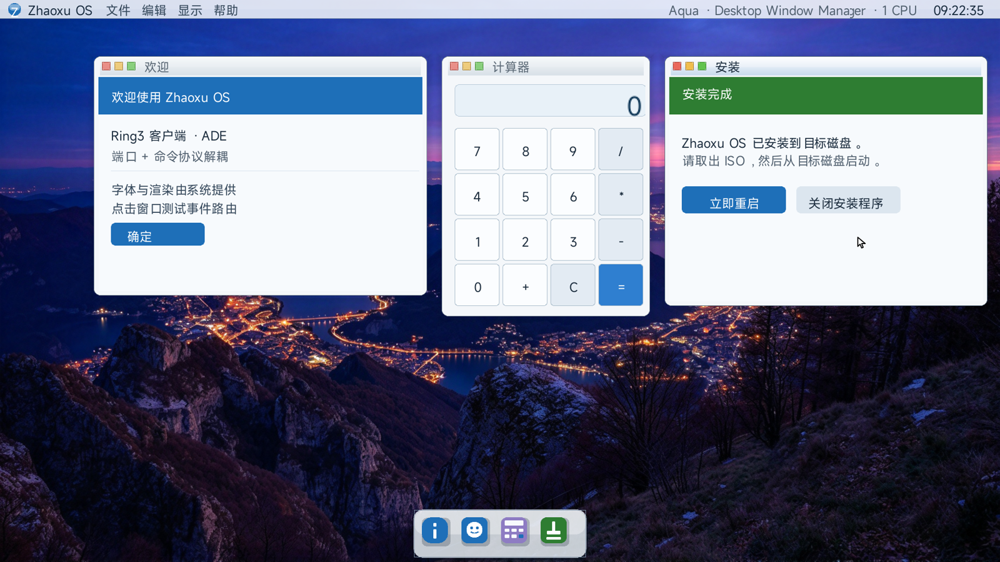

<div align="center">

# Zhaoxu OS

**A microkernel operating system for x86_64**

Yuanshuo kernel · Aqua Desktop Environment · Limine · ZXE v1

<kbd>Microkernel</kbd> <kbd>Ring 3 drivers</kbd> <kbd>UEFI + Legacy BIOS</kbd> <kbd>MBR + GPT</kbd> <kbd>FAT32 + ext4</kbd> <kbd>OS_5P</kbd>

[OSHub](https://oshub.org/projects/zhaoxu-os) · [GitHub](https://github.com/Tinmc189623/zhaoxu-os) · [GitCode](https://gitcode.com/2503_94276351/zhaoxu-os)

**Current version: 0.8.0 「Cedar」, kernel 0.8.0, build 2026-11-27**. Version history in [CHANGELOG.md](CHANGELOG.md)

</div>

---

Zhaoxu OS boots through **Limine** on UEFI and legacy BIOS from a single hybrid ISO. **Yuanshuo** is the C microkernel; hardware drivers, the **Aqua Desktop Environment**, **Desktop Window Compositor** and **Desktop Window Manager** all run in Ring 3. Applications are **ZXE v1** executables using the **Z64 1.0** system interface.

## Release 0.7.21

This release lands the **OS_5P** direction and the first real code for it. It is a prerelease: the hybrid kernel does not boot a personality yet.

**OS_5P personality layer.** The auxiliary in-kernel personality changed from the planned Linux 7.4-rc3 to **FreeBSD 15.1-RELEASE** (BSD-2-Clause). The hybrid kernel is named `OS_5P` and its device framework is `IO/287`, in the IOKit role. CDDL-only parts of the tree (`sys/contrib/openzfs`, `sys/cddl`) stay unlinked.

| Stage | Content | State |
| --- | --- | --- |
| M1 | Task threads, reserved VM window, trap forwarding, timer service, kernel IPC endpoints | Delivered, verified by `PERSONALITY_SELFTEST=1` |
| M3 core | `personality_start()` boot hand-off, `personality_console_write()` | Delivered |
| M2 slices 1–4 | `FREEBSD_PERSONALITY` build gate, weak boot seam, linker set symbols, shared `core_abi.h`, pmap window probe | Landed |
| M2 machine port | pmap ownership, interrupts, timer, `cn(4)` backend | Not started |
| M3–M5 | `mi_startup`, UFS2/GEOM/network, syscall routing | Blocked on the line above |

A `buildkernel KERNCONF=ZHAOXU` inside the FreeBSD 15.1 VM completes in 162 seconds; the personality is not linked into `KERNEL.ELF` yet.

**Scripts.** Every repository script is Python 3 (rule 6). ZXE packing, initramfs compression, ISO metadata and the smoke test were checked against the previous Ruby tools; `make iso` builds and boots to `Boot complete`.

**Architecture document.** `docs/architecture/` holds an A4 architecture document (HTML source plus generator); the PDF is a release asset.

## Platform

**Boot.** Limine 12.10.0 is used as shipped. UEFI loads `EFI/BOOT/BOOTX64.EFI`; legacy BIOS loads Limine's boot sector and stage 2, which reads `limine.conf` through its own FAT/ISO9660 driver. Both paths enter the Limine protocol implemented in `kernel/boot/limine_boot.c`, which builds the 64 GiB identity map and hands over `struct boot_info`.

**Installer.** The ISO boots straight into setup: the default Limine entry passes `cmdline: install`, and the kernel starts a text-mode setup program on the console, the way an XP setup disc behaves. It walks through welcome, licence, disk selection, GPT/MBR and data-partition choice, a format warning and a progress screen, then restarts. No desktop and no compositor run on the medium. GPT is the default, MBR behind an advanced toggle. Custom layout adjusts the FAT32 ESP and an optional FAT32 `ZHAOXUDATA` partition; the ext4 root takes the rest. Because Limine 12 reads FAT and ISO9660 but not ext4, the ESP carries `KERNEL.ELF`, `MiSans.ttf` and `WALL.RGB` under
`/boot/limine`.

**Kernel.** Yuanshuo owns CPU, memory, scheduling, IPC, VFS core and the page tables. User images load in `[1 TiB, 1 TiB + 1 GiB)` at a random 64 KiB-aligned base with W^X enforced. Z64 1.0 syscalls use `int 0x80` with `rax`, `rdi`, `rsi`, `rdx`, `r10`; numbers 0–78 cover files, processes, IPC, block I/O, install, fork/exec, pipes, `dup2`, `ioctl` and `stat`.

**Storage.** `/` is an initramfs-backed rootfs with copy-up to ramfs; `/mnt` is the FAT32 `ZHAOXUDATA` volume or the embedded data mirror. `/bin/ext4fs` is the only process holding the trusted block capability.

**Desktop.** Clients speak the ADE protocol over a named port. Desktop Window Manager owns z-order, focus, dragging and damage; Desktop Window Compositor keeps the system-RAM back buffer and presents damaged rectangles. All drawing replays through `kernel/gfx/render.c`, shared with Ring 3.

## Build

The build system is the Makefile under `src/`. WSL2 is the preferred host on Windows.

```bash
cd src
make -j4                 # kernel, Ring 3 programs and the initramfs
make iso                 # out/zhaoxu-os_x64_{version}_{build}_ld.iso
make run-iso             # UEFI boot in QEMU
make run-bios            # SeaBIOS boot in QEMU
make host-test           # Python host-detection tests
```

A clean ISO build needs `xorriso`, `mtools`, `dosfstools`, `qemu`, OVMF and SeaBIOS firmware, and `ffmpeg` for the wallpaper conversion. The kernel needs a freestanding x86_64 toolchain, `ld.lld` and `objcopy`; Ring 3 drivers are Ada and need a GNAT with Ada 2022 support.

The newlib/ncurses/nano ports are separate, cached builds:

```bash
python3 tools/newlib.py       # PIC newlib 4.6 under $HOME/newlib
python3 tools/posix-ports.py  # support library, ncurses and nano
```

`tools/build.py` is a convenience wrapper, not the build system.

### Try the installer

```bash
make run-install         # ISO plus a blank 256 MiB target image, GPT by default
make run-install-bios    # same target, MBR path
```

The target disk is erased from LBA 0. Use a disposable image or a disk you do not need.

## Screenshots

<table>
<tr>
<td width="50%" align="center">

<br><b>Aqua Desktop Environment</b><br>
<sub>Menu bar, welcome window, calculator, Dock and the compositor cursor at 1920×1080</sub>
</td>
<td width="50%" align="center">

<br><b>Applications and installer</b><br>
<sub>Welcome and calculator clients running on the Aqua desktop; TrueType Chinese text</sub>
</td>
</tr>
<tr>
<td width="50%" align="center">

<br><b>Installer</b><br>
<sub>Target disk list, automatic or custom layout, one confirmation and real stage progress</sub>
</td>
<td width="50%" align="center">

<br><b>Custom partitions</b><br>
<sub>FAT32 ESP size and the optional ZHAOXUDATA data partition; ext4 takes the rest</sub>
</td>
</tr>
</table>

## Known gaps

These are open items, listed so the release notes are not mistaken for a completion claim.

- **OS_5P** does not boot a personality. M2's machine port is unstarted, so M3–M5 have no evidence yet. Rules r5 and r9 need an owner amendment for in-kernel drivers and in-kernel C++.
- **Shell.** GNU bash 5.3 ships as `/bin/bash`; rule 1 requires csh as the default shell, which is not ported yet. Job control, asynchronous signals and toybox (rule 36) are pending.
- **File systems.** Rule 21 requires complete FAT32, ext4 and btrfs support; btrfs is not implemented. FS+ (rule 45) exists as an on-disk format core and host tests, not as the installed root.
- **Graphics.** Rules 37 and 38 are not met: the desktop renders through the Z64 software path. The Vulkan 1.0 ICD has no WSI, descriptors/UBOs, compute or depth; OpenGL 1.1 is a subset.
- **Boot chain.** Rule 31 names `vga10h.kext`; the kernel module loader is not implemented and `/bin/drivers.udrv` runs from the initramfs.
- **Ports.** nano 8.4 compiles against newlib and ncurses but is not yet relinked as a ZXE image or started inside the system.
- **Hardware and security.** No network stack, audio or USB HID. Images are unsigned, so Secure Boot must be off; see [SECURITY.md](SECURITY.md).

## Documentation

| Document | Contents |
| --- | --- |
| [RULES.md](RULES.md) | Project rules that override everything else |
| [AGENTS.md](AGENTS.md) | Invariants and the validation checklist |
| [docs/INSTALL.md](docs/INSTALL.md) | Installation, first boot and troubleshooting |
| [docs/architecture/](docs/architecture/) | A4 architecture document and its generator |
| [ROADMAP.md](ROADMAP.md) | What is being built next |
| [SECURITY.md](SECURITY.md) | Reporting vulnerabilities and the security model |
| [CONTRIBUTING.md](CONTRIBUTING.md) | Build, test and pull-request rules |
| [CHANGELOG.md](CHANGELOG.md) | Full release history |
| [THIRD_PARTY_NOTICES.md](THIRD_PARTY_NOTICES.md) | Vendored components and font licenses |

## License

This project is licensed under the [GNU General Public License v2.0](LICENSE) (GPL-2.0-only). The FreeBSD personality is BSD-2-Clause and compatible; CDDL-only subsystems stay unlinked. Third-party notices are in [THIRD_PARTY_NOTICES.md](THIRD_PARTY_NOTICES.md).

<div align="center">

**Zhaoxu OS, Yuanshuo**. Built with C / GAS / Ada / C++ / Python.

Copyright (C) 2026 Nexsteaduser, Nexlyh, Tinmc189623. All Rights Reserved. Email: admin@nexsteaduser.com

</div>
