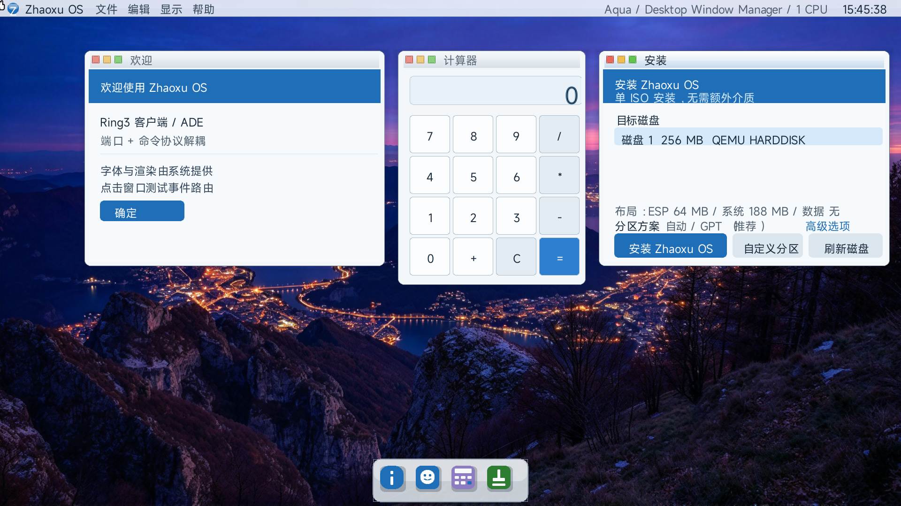
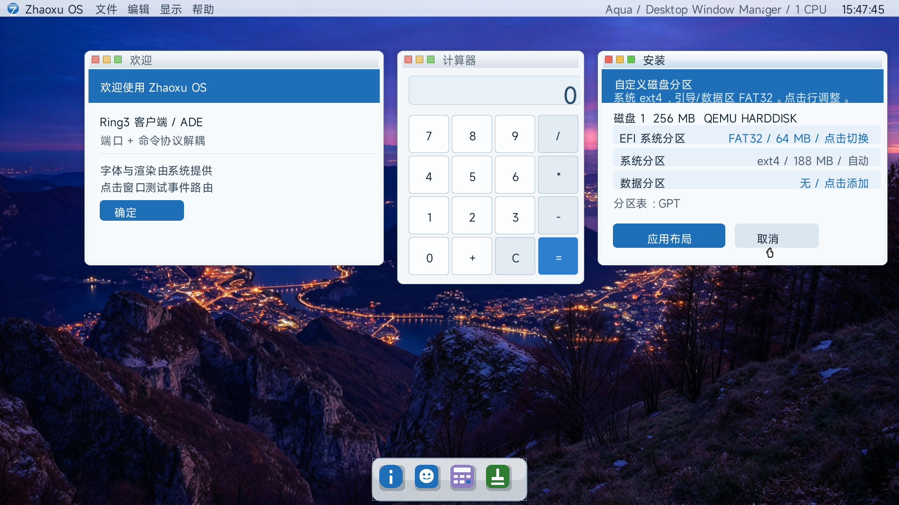

<div align="center">

# 🖥️ Zhaoxu OS

### Yuanshuo, Aqua Desktop Environment, x86_64

<kbd>🧩 Microkernel</kbd> <kbd>🧵 Ring 3 user mode</kbd> <kbd>💾 FAT32 + ext4</kbd> <kbd>💿 UEFI + Legacy BIOS</kbd> <kbd>🧬 MBR + GPT</kbd> <kbd>🎨 Aqua</kbd>

**C** kernel, **Limine** UEFI/BIOS boot, **GAS** low-level assembly, **Ada** drivers, **C++20** applications, **Python** toolchain

[🌐 OSHUB](https://oshub.org/projects/zhaoxu-os) [🐙 GitHub](https://github.com/Tinmc189623/zhaoxu-os) [🦊 Gitee](https://gitee.com/Tinmc189623/zhaoxu-os) [🦄 GitCode](https://gitcode.com/2503_94276351/zhaoxu-os)

**Current version: 0.7.21 「Yuanshuo」, kernel 0.7.1, build 2026-11-21**. Version history in [CHANGELOG.md](CHANGELOG.md)

</div>

---

> 🧭 **In one sentence**: Zhaoxu OS is an x86_64 microkernel operating system. **Limine** boots it on UEFI and legacy BIOS, **Yuanshuo** is the C kernel, drivers and the **Aqua Desktop Environment** desktop run in ring 3, the compositor is **Desktop Window Compositor** and the window manager is **Desktop Window Manager**. Applications are **ZXE v1** executables using the **Z64 1.0** system API.

---

## ✨ What this build does

### Boot and install

- Limine 12.10.0 boots the kernel on both UEFI and legacy BIOS from one hybrid ISO. Stage 1, stage 2, the EFI loader and the installed ESP are all written by the installer.
- The graphical installer scans disks, recognises a blank disk or a previous Zhaoxu install, auto-selects one target and asks for a single confirmation. GPT is the default; MBR is behind the advanced toggle.
- Custom partitioning adjusts the FAT32 ESP and an optional FAT32 `ZHAOXUDATA` partition; the ext4 root takes the rest.
- The ESP carries Limine, `KERNEL.ELF`, `KERNEL.BIN`, `MiSans.ttf` and `WALL.RGB`, because Limine 12 reads FAT and ISO9660 but not ext4. The ext4 `ZHAOXUROOT` volume carries the installed file system with no boot files.
- Installs were verified end to end on a blank 256 MiB disk in both GPT and MBR layouts, then booted under OVMF and SeaBIOS.

### Kernel and ABI

- Yuanshuo owns CPU, memory, scheduling, IPC, VFS core and the page tables. Every hardware driver lives in Ring 3 `/bin/drivers`; the kernel contains no driver or desktop code.
- User images load in `[1 TiB, 1 TiB + 1 GiB)` at a random 64 KiB-aligned base with W^X enforced: code is RX, rodata is R, data and zero-fill are RW.
- Z64 1.0 syscalls use `int 0x80` with `rax`, `rdi`, `rsi`, `rdx`, `r10`. Numbers 0–77 cover files, processes, IPC, block I/O, install, fork/exec, pipes, `dup2`, `ioctl` and `stat`.
- `fork()` copies the caller's pages and descriptor table and resumes the child after the syscall with `rax=0`; `exec()` loads a new image into a fresh address space and rewrites the interrupt frame.

### POSIX and ports

- newlib 4.6 is built PIC for x86_64-elf and linked through the ZOS libgloss layer: `fork`, `exec`, `pipe`, `dup2`, stdio redirection, tty/termios, `stat`, `lseek` and directory streams.
- ncurses 6.5 builds against that layer and the `zhaoxu` terminfo entry; a real `initscr/printw/refresh/endwin` program reports `ncurses hello: 80x25 ok`.
- nano 8.4 compiles against newlib and ncurses, using upstream gnulib. It is not yet relinked as a ZXE PIE or started inside the system.

### Desktop and graphics

- Aqua Desktop Environment runs as the Ring 3 display server. Window chrome, Dock, menu bar, wallpaper, damage-only composition and the cursor live in separate files.
- The framebuffer path was fixed to keep BGRX native; blue window chrome stays blue instead of being swapped to orange.
- A software OpenGL 1.1 subset (matrices, primitives, depth, textures, lighting, blending, scissor, `glReadPixels`) and a software Vulkan 1.0 ICD (SPIR-V interpreter, CPU rasterizer) are present in `src/user/lib`.
- The desktop itself still renders through the ZOS software raster path; Vulkan is not the default compositor backend yet, and the Vulkan ICD has no WSI/swapchain, descriptors/UBOs, compute or depth.

### Wayland

- Desktop Window Compositor speaks Wayland. Kernel eventfd, timerfd and epoll back the event loop, and the stock libwayland 1.23.1 client core runs with an SCM_RIGHTS `wl_shm` frame in the regression client.
- The Ring 3 KMS service (`/bin/display`), GBM buffer allocation and dmabuf sharing are the next milestones.

---

## 📷 Screenshots

<table>
<tr>
<td width="50%" align="center">

<br><b>🎨 Aqua Desktop Environment</b><br>
<sub>Menu bar, welcome window, calculator, Dock and the compositor cursor at 1920×1080</sub>
</td>
<td width="50%" align="center">

<br><b>🧮 Applications and installer</b><br>
<sub>Welcome and calculator clients next to the completed graphical installer; TrueType Chinese text</sub>
</td>
</tr>
<tr>
<td width="50%" align="center">

<br><b>📥 Installer</b><br>
<sub>Target disk list, automatic or custom layout, one confirmation and real stage progress</sub>
</td>
<td width="50%" align="center">

<br><b>💿 Custom partitions</b><br>
<sub>FAT32 ESP size and the optional ZHAOXUDATA data partition; ext4 takes the rest</sub>
</td>
</tr>
</table>

---

## 🚀 Build and run

The build system is the Makefile under `src/`. WSL2 is the preferred host on Windows.

```bash
cd src
make -j4                 # kernel, ring 3 programs and the initramfs
make iso                 # out/zhaoxu-os_x86-64_{version}_{build}_ld.iso
make run-iso             # UEFI boot in QEMU
make run-bios            # SeaBIOS boot in QEMU
make host-test           # Python host-detection tests
```

A clean ISO build needs `xorriso`, `mtools`, `dosfstools`, `qemu`, OVMF and
SeaBIOS firmware, and `ffmpeg` for the wallpaper conversion. The C kernel
needs a freestanding x86_64 toolchain, `ld.lld` and `objcopy`; the Ring 3
drivers are written in Ada and need a GNAT with Ada 2022 support.

The newlib/ncurses/nano ports are separate, cached builds:

```bash
python3 tools/newlib.py       # PIC newlib 4.6 under $HOME/newlib
python3 tools/posix-ports.py  # compiles the support library, ncurses and nano
```

`tools/build.py` is a convenience wrapper; it is not the build system. All
repository scripts are Python, sh or ps1, per rule 6.

### Try the installer

```bash
make run-install         # ISO plus a blank 256 MiB target image, GPT by default
make run-install-bios    # same target, MBR path
```

The target disk is erased from LBA 0. Use a disposable image or a disk you do
not need.

---

## 🏗️ Architecture

**Boot chain.** `Limine → kernel.elf → vga.ko`. `kernel/boot/limine_boot.c`
implements the Limine protocol, installs the 64 GiB identity map over Limine's
HHDM tables, maps the BSS boot stack, and converts the memory map, framebuffer,
RSDP, executable address and modules into `struct boot_info`.

**Microkernel boundary.** `kernel/` owns CPU, memory, scheduling, IPC and VFS.
AHCI, PS/2, RTC, serial and the framebuffer are driven by Ring 3 services
through four shared pages. `/bin/ext4fs` is the only process holding the trusted
block capability; `/bin/display` alone receives scanout and BAR mappings.

**Storage.** `/` is the initramfs-backed rootfs; `/mnt` is the FAT32
`ZHAOXUDATA` volume or the embedded data mirror. The installer formats the ESP
and the optional data volume itself and delegates the ext4 root to the Ring 3
ext4 service.

**Desktop.** Clients speak the ADE protocol over a named port. Desktop Window
Manager owns z-order, focus, dragging and damage; Desktop Window Compositor
keeps the system-RAM back buffer and presents damaged rectangles. All drawing
replays through `kernel/gfx/render.c`, shared with the kernel and Ring 3.

**User executables.** ZXE v1 is a PIE packed by `tools/zxe-pack.py`. Dependencies
load from `/lib` by plain filename; there is no ELF dynamic linker. The kernel
and user code are freestanding: no libc in the kernel, no SSE outside the
font code.

---

## ⚠️ Known gaps

- GNU bash 5.3 is cross-built as `/bin/bash` and starts on a boot without a
  framebuffer. Job control and asynchronous signal delivery are not implemented
  yet, and toybox plus the full Unix command set are still pending.
- nano compiles but is not ZXE-linked or runnable inside the system yet.
- Vulkan is not the default renderer; the ICD lacks WSI, descriptors/UBOs,
  compute and depth. OpenGL 1.1 is a subset, not a complete implementation.
- There is no network stack, audio, USB HID or user-account separation.
- The kernel and user images are unsigned; Secure Boot must be off. See
  [SECURITY.md](SECURITY.md) for the threat model and known hardening gaps.

---

## 📚 Documentation

| Document | What it covers |
| --- | --- |
| [RULES.md](RULES.md) | The project rules that override everything else |
| [AGENTS.md](AGENTS.md) | Detailed invariants and the validation checklist |
| [docs/INSTALL.md](docs/INSTALL.md) | Installation, first boot and troubleshooting |
| [ROADMAP.md](ROADMAP.md) | What is being built next |
| [SECURITY.md](SECURITY.md) | Reporting vulnerabilities and the security model |
| [CONTRIBUTING.md](CONTRIBUTING.md) | Build, test and pull-request rules |
| [CHANGELOG.md](CHANGELOG.md) | Full release history |
| [THIRD_PARTY_NOTICES.md](THIRD_PARTY_NOTICES.md) | Vendored components and font licenses |

---

## 📜 License

This project is licensed under the [GNU General Public License v2.0](LICENSE)
(GPL-2.0-only; FreeBSD's BSD-2-Clause personality is compatible and CDDL-only
subsystems stay unlinked). Third-party component and font notices are in
[THIRD_PARTY_NOTICES.md](THIRD_PARTY_NOTICES.md).

<div align="center">

**Zhaoxu OS, Yuanshuo**. Built with C / GAS / Ada / C++ / Python.

Copyright © 2026 Nexsteaduser. All Rights Reserved. Email: admin@nexsteaduser.com

</div>
