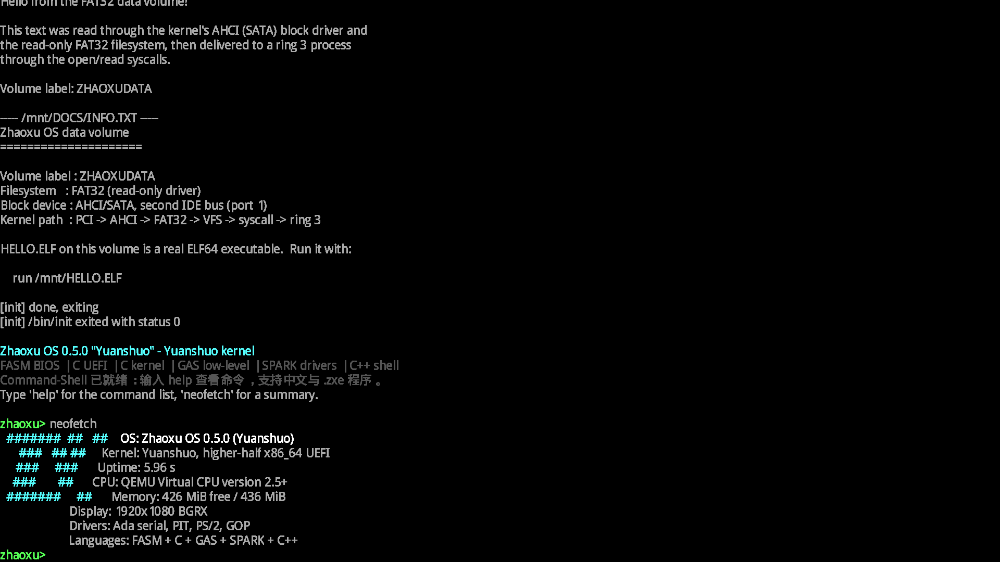
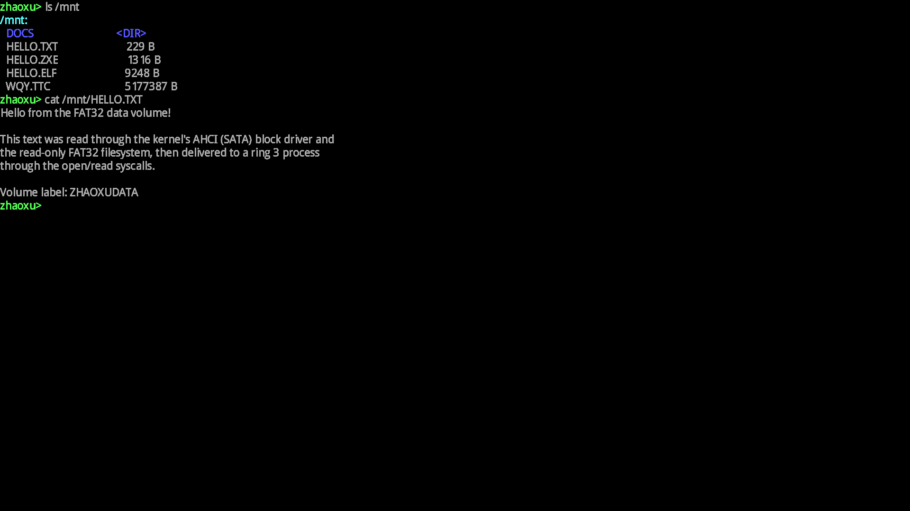
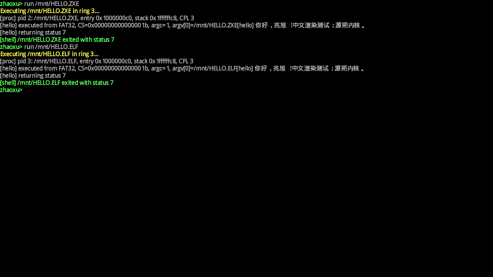
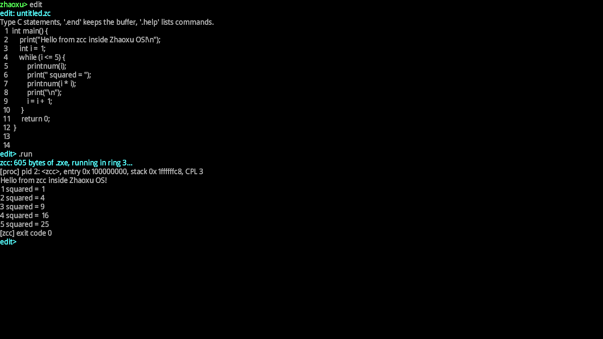
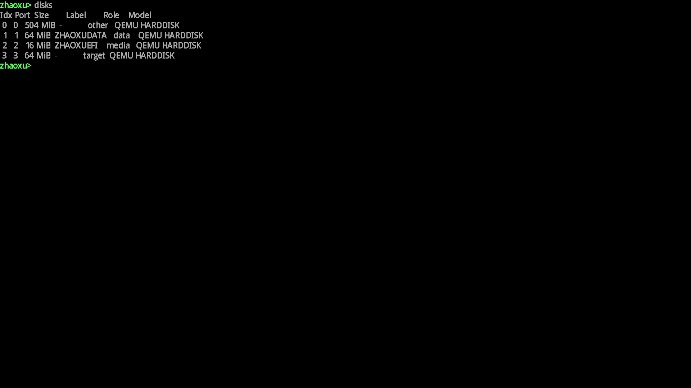
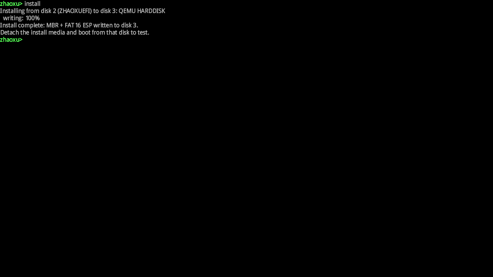
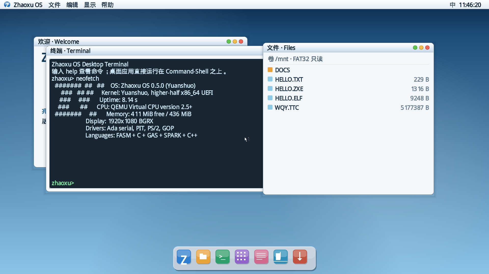
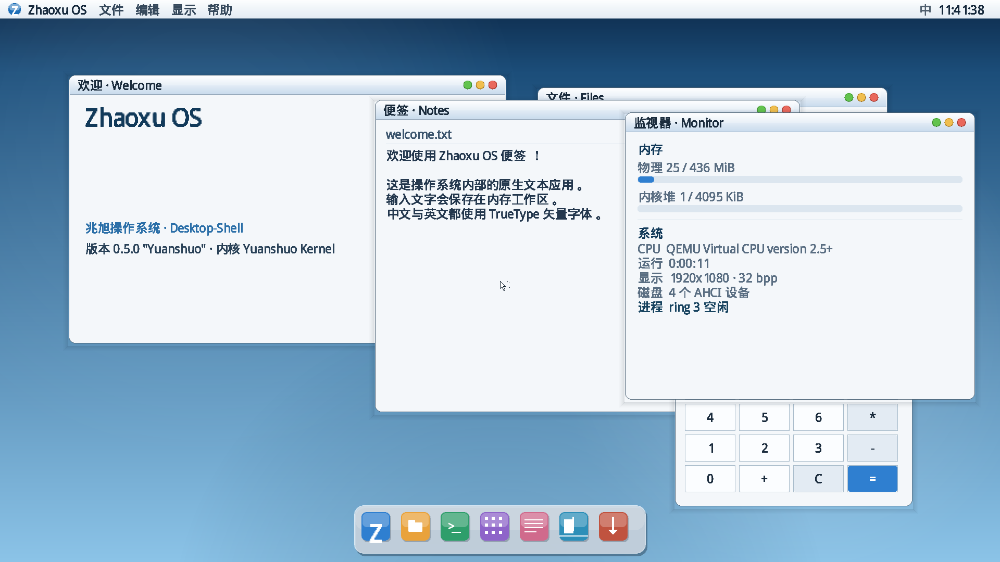
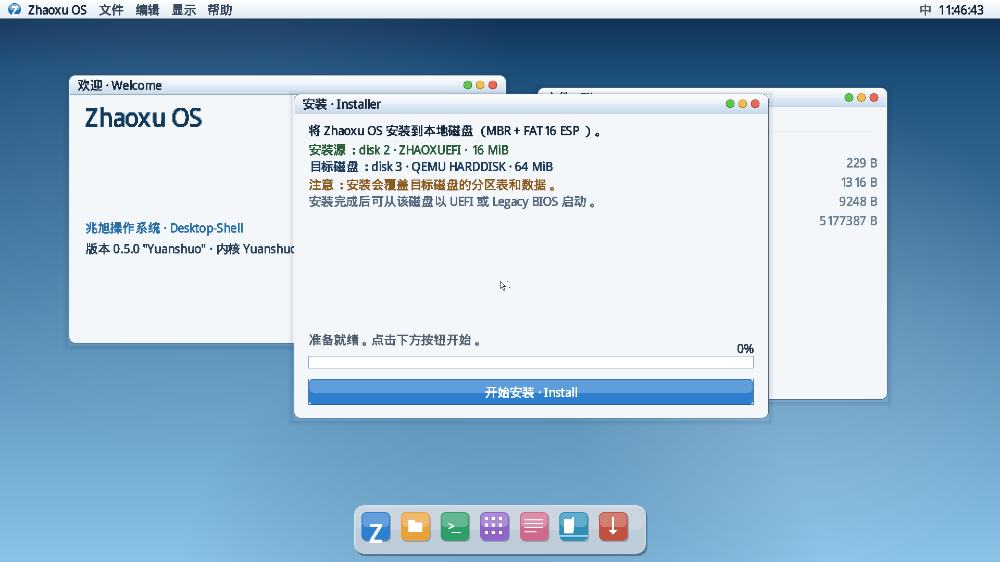
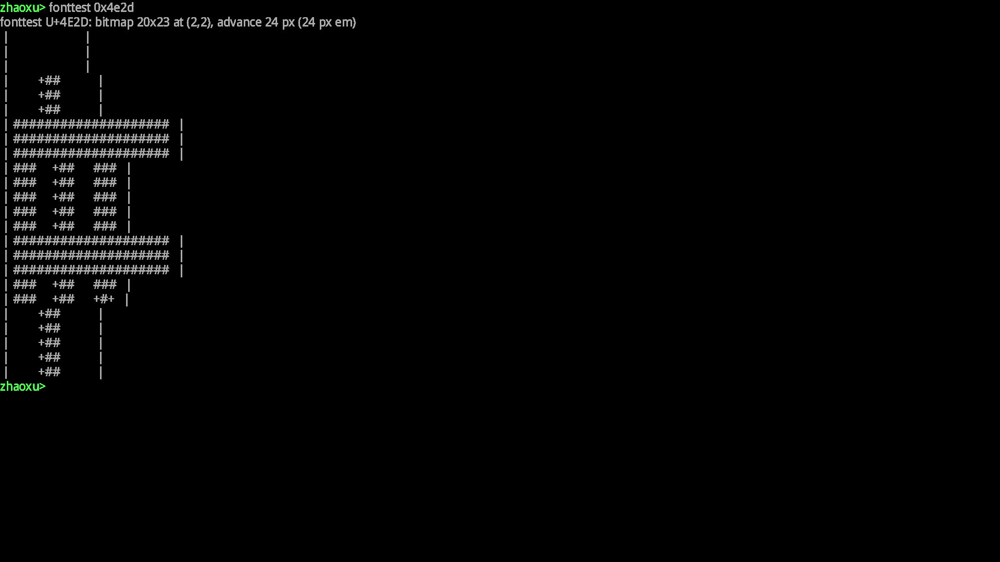

<div align="center">

# 🖥️ Zhaoxu OS

### Yuanshuo Kernel · Aqua Desktop · x86_64

<kbd>🧩 微内核</kbd> <kbd>🧵 Ring 3 用户态</kbd> <kbd>💾 FAT32</kbd> <kbd>💿 UEFI + Legacy BIOS</kbd> <kbd>🧬 MBR + GPT(ISO)</kbd> <kbd>🎨 Aqua</kbd>

**C** 内核与 UEFI 引导 · **FASM** BIOS 引导 · **GAS** 底层汇编 · **Ada** 驱动 · **C++20** 上层应用 · **Ruby** 工具链

[🌐 OSHUB](https://oshub.org/projects/zhaoxu-os) · [🐙 GitHub](https://github.com/Tinmc189623/zhaoxu-os) · [🦊 Gitee](https://gitee.com/Tinmc189623/zhaoxu-os) · [🦄 GitCode](https://gitcode.com/2503_94276351/zhaoxu-os)

**当前版本：0.5.0 「Yuanshuo」** · 历史版本见 [CHANGELOG.md](CHANGELOG.md)

</div>

---

> 🧭 **一句话介绍**：Zhaoxu OS 是一个完全从零编写的 x86_64 操作系统。引导加载器 **ZhaoxuBootloader** 同时支持 UEFI 与 legacy BIOS；**Yuanshuo Kernel** 是 C 编写的微内核；驱动由 **Ada** 实现；Shell **csh** 由 C 编写、桌面 **ADE** 由 **C++20** 编写，二者都运行在 ring 3 之上；系统内部还带有一个 C 子集编译器 **zcc**，可以直接在操作系统里写程序、编译成 `.zxe` 并运行。

---

## ✨ 0.5.0 亮点

<table>
<tr>
<td width="50%" valign="top">

### 🖼️ ADE
- Aqua 风格图形桌面：渐变菜单栏、RTC 时钟、Dock
- `DWM` 窗口管理器：拖动、关闭、层叠、焦点
- 原生应用：终端、文件、计算器、便签、监视器
- 软件光标 + PS/2 鼠标，Dock 启动 ADE 客户端与 Ring 3 程序

</td>
<td width="50%" valign="top">

### 🛠️ 系统内开发
- `edit`：系统内 C 编辑器（带示例程序）
- `cc`：把编辑缓冲区交给内置编译器 **zcc**
- **zcc** 直接生成 `.zxe` 机器码镜像，在 ring 3 执行
- 自研 `.zxe` 格式，同时保留完整 ELF64 兼容路径

</td>
</tr>
<tr>
<td width="50%" valign="top">

### 💿 双启动 + 图形安装器
- UEFI（C 引导层）与 legacy BIOS（FASM stage1/2）
- ISO 采用 GPT hybrid（UEFI + El Torito 双入口）；安装目标盘支持 MBR 与 GPT
- 单 ISO 安装：内置图形安装器，可选 MBR 或 GPT，现场格式化 FAT32 ESP 与 `ZHAOXUDATA` 数据分区
- AHCI 写入、扇区校验、安装后可直接启动

</td>
<td width="50%" valign="top">

### 🔌 完整驱动栈（Ada）
- ACPI：RSDP/XSDT/FADT/DSDT、`_S5` 解析、关机与重启
- PCI / PCIe 枚举、AHCI、IDE、SATA、SCSI（ATAPI）
- PIT、PS/2 键盘与鼠标、GOP 帧缓冲、16550 UART
- TrueType 中文渲染：文泉驿微米黑，UTF-8 控制台

</td>
</tr>
</table>

---

## 📸 实机截图

> 以下十张图片全部由 `tools/screenshot.rb` 在 QEMU + OVMF 实机启动后抓取帧缓冲得到，**1920×1080**，非绘制示意图。

<table>
<tr>
<td width="50%" align="center">

<br><b>🖥️ csh</b><br>
<sub>neofetch：0.5.0 内核摘要与语言构成</sub>
</td>
<td width="50%" align="center">

<br><b>💾 FAT32 数据盘</b><br>
<sub><code>ls /mnt</code> 与 <code>cat</code>，AHCI → FAT32 → VFS → 系统调用</sub>
</td>
</tr>
<tr>
<td width="50%" align="center">

<br><b>🧵 Ring 3 程序</b><br>
<sub>同一份 hello 程序分别以 <code>.zxe</code> 与 ELF64 运行，退出码 7</sub>
</td>
<td width="50%" align="center">

<br><b>🛠️ 系统内开发</b><br>
<sub><code>edit</code> 写代码 → <code>.run</code> → zcc 生成 605 字节 .zxe → ring 3 输出</sub>
</td>
</tr>
<tr>
<td width="50%" align="center">

<br><b>🗄️ 磁盘与角色</b><br>
<sub><code>disks</code>：ZHAOXUDATA 数据分区 / ZHAOXUEFI ESP / 空白目标盘</sub>
</td>
<td width="50%" align="center">

<br><b>📥 安装器</b><br>
<sub><code>install</code>：目标盘写入 MBR/GPT + FAT32 ESP + ZHAOXUDATA 并校验</sub>
</td>
</tr>
<tr>
<td width="50%" align="center">

<br><b>🎨 ADE · Aqua</b><br>
<sub>菜单栏、窗口、Dock、软件光标；终端里运行真实的 neofetch</sub>
</td>
<td width="50%" align="center">

<br><b>🧮 原生桌面应用</b><br>
<sub>欢迎、便签、监视器、计算器；TrueType 中文排版</sub>
</td>
</tr>
<tr>
<td width="50%" align="center">

<br><b>💿 图形安装器</b><br>
<sub>识别安装源与目标盘，确认后开始写入，支持 UEFI/BIOS 启动</sub>
</td>
<td width="50%" align="center">

<br><b>🔤 TrueType 字形</b><br>
<sub><code>fonttest 0x4e2d</code>：20×23 位图、24 px em，中文字形光栅输出</sub>
</td>
</tr>
</table>

---

## 🧠 架构

**微内核结构**：`kernel.elf` 只包含 CPU/内存/调度/IPC/VFS 核心，不含任何驱动或应用；AHCI、PS/2、鼠标、RTC、串口由 Ring 3 `/bin/drivers` 独占，ADE、csh 与全部应用同样是 Ring 3 程序（规则 9）。

<table>
<tr><th>层</th><th>语言</th><th>实现</th></tr>
<tr><td>UEFI 引导</td><td>🧩 C + GAS</td><td><code>boot/efi_main.c</code>：GOP、RSDP、内存映射、页表、<code>ExitBootServices</code></td></tr>
<tr><td>Legacy BIOS 引导</td><td>⚙️ FASM</td><td><code>bios_stage1.asm</code> → <code>bios_stage2.asm</code>：VBE、E820、长模式</td></tr>
<tr><td>内核</td><td>🔧 C</td><td><code>kernel/</code>：GDT/TSS、IDT、PMM/VMM、堆、进程、VFS、FAT32；不含任何驱动</td></tr>
<tr><td>底层汇编</td><td>🧱 GAS</td><td>入口、ISR 桩、用户态切换、内核镜像嵌入</td></tr>
<tr><td>驱动</td><td>✨ Ada + C，Ring3</td><td><code>/bin/drivers</code>：AHCI、PS/2、鼠标、RTC、UART；内核通过共享页 RPC 访问</td></tr>
<tr><td>Shell / 桌面 / 应用</td><td>🚀 C + C++20</td><td><code>apps/csh/</code>（csh，C，每命令一文件）、<code>apps/ADE/</code>（C++20）、<code>apps/zcc/main.cpp</code></td></tr>
<tr><td>用户程序</td><td>🧵 C</td><td><code>user/</code>：<code>init</code>、<code>hello</code>，链接到 <code>0x10000000000</code>（1 TiB），运行在 ring 3</td></tr>
<tr><td>工具链</td><td>💎 Ruby</td><td><code>tools/</code>：ELF→.zxe、BIOS 镜像、冒烟测试、实机截图、版本同步</td></tr>
</table>

**内存布局**

```
0xffffffff80000000  内核虚拟基址（higher-half）
0xffffffff80f00000  内核栈顶
0xffffffff90000000  4 MiB 内核堆
0x0000000100000000  ring 3 程序加载基址
0x0000000200000000  ring 3 用户栈顶（32 页）
```

**系统调用 ABI**：`int 0x80`，`rax` = 调用号，`rdi/rsi/rdx` = 参数。

| # | 调用 | # | 调用 |
| :---: | --- | :---: | --- |
| 0 | `exit` | 4 | `read` |
| 1 | `write` | 5 | `close` |
| 2 | `getpid` | 6 | `uptime` |
| 3 | `open` | | |

---

## 🚀 引导流程

**UEFI 路径**

1. 固件加载 `EFI/BOOT/BOOTX64.EFI`（C 引导层，`lld-link` 生成 PE64）。
2. 取得 GOP 帧缓冲、ACPI RSDP 与 UEFI 内存映射。
3. 复制内核镜像到 4 GiB 以下的页对齐物理内存，建立低端恒等映射与 higher-half 页表；内核启动后把恒等映射扩展到内存映射覆盖的 64 GiB。
4. `ExitBootServices` → 切换 CR3 → 跳转 `0xffffffff80000000`。

**Legacy BIOS 路径**

1. SeaBIOS 从 El Torito 或 MBR 加载 512 字节 stage 1。
2. stage 1 用 INT 13h 把 stage 2 读入 `0x8000`。
3. stage 2 选择 32bpp VBE LFB、收集 E820、扫描 RSDP，把内核读入低端缓冲。
4. 建立页表、清零 16 MiB 内核窗口、写 `boot_info`，进入长模式。

**内核公共路径**

5. GDT/IDT/PIC → PMM/VMM/堆 → CPUID/ACPI/RTC → AHCI/VFS → TrueType 字体。
6. 挂载 initramfs（`/`）与 FAT32（`/mnt`，卷标 `ZHAOXUDATA`）。
7. 自动以 ring 3 运行 `/bin/init`；有 GOP 帧缓冲时启动 **ADE**，无帧缓冲时进入 **csh**。

---

## 💻 csh 命令

<table>
<tr><th>命令</th><th>说明</th><th>命令</th><th>说明</th></tr>
<tr><td><code>help</code></td><td>命令列表</td><td><code>neofetch</code></td><td>系统摘要</td></tr>
<tr><td><code>version</code></td><td>版本与内核信息</td><td><code>uname</code></td><td>系统标识</td></tr>
<tr><td><code>echo</code></td><td>输出文本</td><td><code>uptime</code></td><td>运行时间</td></tr>
<tr><td><code>ls [path]</code></td><td>列目录</td><td><code>cat &lt;path&gt;</code></td><td>输出文件内容</td></tr>
<tr><td><code>run &lt;path&gt;</code></td><td>以 ring 3 运行 .zxe / ELF64</td><td><code>cpus</code></td><td>在线 CPU 数</td></tr>
<tr><td><code>pid</code></td><td>csh 进程号</td><td><code>rm &lt;path&gt;</code></td><td>删除 /mnt 文件</td></tr>
<tr><td><code>exit</code></td><td>退出 shell</td><td></td><td></td></tr>
</table>

行编辑支持退格与 `Ctrl+C` 取消当前行。

---

## 🧪 系统内开发：edit → cc → zcc

```text
zhaoxu> edit
edit: untitled.zc
 1 int main() {
 2     print("Hello from zcc inside Zhaoxu OS!\n");
 3     int i = 1;
 4     while (i <= 5) { printnum(i); ... }
 5     return 0;
 6 }
zhaoxu> .run
zcc: 605 bytes of .zxe, running in ring 3...
Hello from zcc inside Zhaoxu OS!
1 squared = 1
...
[zcc] exit code 0
```

- **zcc** 支持：`int` 变量、赋值、`print` / `printnum`、`if` / `else`、`while`、比较与四则运算、`return`
- 输出格式为自研 `.zxe` v1：112 字节头 + 段表 + 代码段 + 只读段
- 编译器与编辑器都是内核镜像里的 C++20 代码，不依赖任何外部工具

---

## 📦 构建与运行

构建在 **WSL2**（Ubuntu 26.04）中完成，Windows 脚本只做转发。

```powershell
# Windows（PowerShell 7+）
./src/build.ps1                  # 构建 UEFI 引导
./src/build.ps1 -Headless        # 仅串口输出
./src/run.ps1                    # QEMU + OVMF
./src/run.ps1 -Display gtk       # WSLg 图形窗口
```

```bash
# 或者直接在 WSL 中
cd src
make -j4                         # 构建 out/BOOTX64.EFI
make run                         # 等同 make run-iso（仅光盘启动）
make run QEMU_DISPLAY="-display gtk"
make iso                         # 生成 out/zhaoxu_{version}_installer.iso（UEFI + BIOS）
make run-iso                     # 仅从 ISO 启动（UEFI），不挂数据盘
make run-install                 # ISO + 单个空白目标盘（UEFI 安装测试）
make run-bios                    # 仅从 ISO 启动（SeaBIOS）
make run-install-bios            # ISO + 单个空白目标盘（BIOS 安装测试）
```

**依赖**：`gcc`、`g++`、`gcc-14` + `gnat-14`、`ld.lld`、`objcopy`、`clang`、`qemu-system-x86_64`、OVMF、`mkfs.vfat`、`mtools`、`tar`、`xorriso`；FASM 已随仓库提供（`src/tools/fasm`）。

**验证工具**（Ruby）：

```bash
ruby tools/smoke.rb <marker> [commands]     # 无头冒烟，逐条发送 csh 命令
ruby tools/screenshot.rb 3.0 out/shot.png   # 实机启动并抓取帧缓冲
SMOKE_BOOT=iso-install ruby tools/smoke.rb ... # ISO + 空白目标盘安装测试
SMOKE_BOOT=installed ruby tools/smoke.rb ...   # 从安装后的目标盘启动
```

---

## 🗂️ 目录结构

```
Zhaoxu OS/
├── README.md                 当前版本说明（历史见 CHANGELOG.md）
├── CHANGELOG.md              全部版本记录
├── LICENSE                   Apache License 2.0
├── THIRD_PARTY_NOTICES.md    第三方代码与字体声明
├── version.php               版本号唯一来源（make version 同步）
├── docs/                     十张实机截图
└── src/
    ├── Makefile              WSL2 构建规则
    ├── boot/
    │   ├── efi_main.c        UEFI 引导层（C）
    │   ├── bios_stage1.asm   MBR 引导扇区（FASM）
    │   └── bios_stage2.asm   实模式 → 长模式（FASM）
    ├── kernel/
    │   ├── arch/x86_64/      入口、GDT/TSS、ISR、PIC、ring 3 切换
    │   ├── int/              IDT 与异常/IRQ/系统调用
    │   ├── drivers/          PIT、键盘、RTC、ACPI 胶水、AHCI 日志
    │   ├── fs/               initramfs、FAT32、VFS、安装器
    │   ├── proc/             .zxe / ELF64 加载与系统调用
    │   ├── mem/              PMM、VMM、堆
    │   ├── lib/              字符串、printf、UTF-8 控制台、C++ 运行时
    │   ├── font/             8x8 点阵 + TrueType glyf 光栅化
    │   └── include/          内核公共头文件
    ├── drivers/              Ada 驱动（ACPI、PCI/PCIe、AHCI、IDE、SATA、SCSI…）
    ├── apps/                 csh（C）+ ADE（C++20）+ 编辑器 + zcc
    ├── user/                 ring 3 程序与用户库
    ├── initramfs/            ramfs 初始内容与数据盘素材
    ├── tools/                Ruby：zxe-pack、bios-img、smoke、screenshot
    └── out/                  构建产物（kernel.elf、ISO）
```

---

## ⚠️ 当前限制

- 🧵 单核、无调度器；同一时刻只运行一个 ring 3 进程，尚无 fork/exec
- 💾 文件系统：FAT32 支持文件级创建/覆盖/删除（8.3 短名）；ext4 尚未接入，FAT32 目录创建与长文件名写入未支持
- 🔤 单 ISO 启动时，UEFI 加载器从光盘根 `/install/WQY.TTC` 预读字体；安装后的系统从目标盘 `ZHAOXUDATA` 数据分区读取；数据盘上的 MiSans/MiSans Global/Inter 优先
- 🧠 用户进程共享内核页表，依靠页级 `U/S` 位隔离
- 🌐 无网络协议栈
- ⌨️ 输入为 PS/2 键盘/鼠标与 COM1 串口
- 🖼️ 显示依赖 UEFI GOP 或 VBE LFB 帧缓冲
- 🔌 存储驱动覆盖 AHCI/IDE/SATA/SCSI（ATAPI），暂无 NVMe 与 USB 存储

---

## 📜 许可证

本项目采用 [Apache License 2.0](LICENSE)。第三方组件与字体声明见 [THIRD_PARTY_NOTICES.md](THIRD_PARTY_NOTICES.md)。

<div align="center">

**Zhaoxu OS · Yuanshuo Kernel** · 用 C / FASM / GAS / Ada / C++ 从零构建

Copyright © 2026 Nexsteaduser. All Rights Reserved. · admin@nexsteaduser.com

</div>
